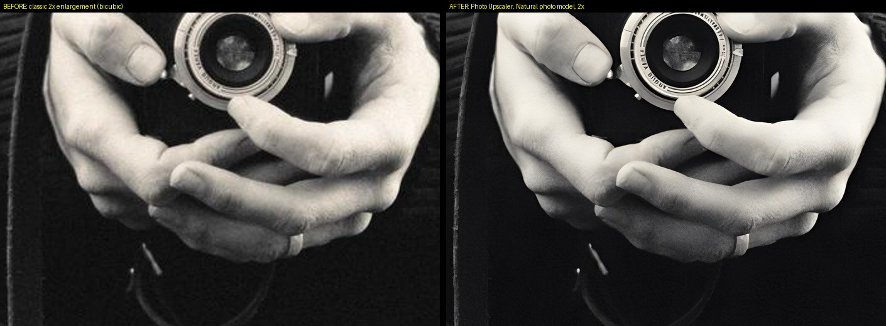

# Photo Upscaler

Make your photos bigger and sharper for large prints or tight crops, with AI that runs on your own
computer. Nothing is uploaded, there's no account, and there's no cost per photo.



## Install

1. Download the latest version from the [Releases page](https://github.com/asen-borisov/photo-upscaler/releases/latest):
   `PhotoUpscaler-…-windows.zip`.
2. Right-click the zip → **Extract All…** → **Extract**.
3. Open the new folder and double-click **Photo Upscaler.exe**.
   The first time, Windows may say "Windows protected your PC": click **More info → Run anyway**.

Nothing else to install. The full step-by-step guide is [READ ME FIRST.txt](READ%20ME%20FIRST.txt)
(also inside the download).

## Use

1. Drag photos or a folder into the window, or click **Add photos**.
2. Pick an **AI model** and an **output size** on the right.
3. Click **Upscale**. Each photo shows its progress and the time left.
4. Click a finished photo to compare **before / after**. Click the picture to see real pixels (100%).
5. Your new photos are in an **Upscaled** folder next to the originals.

| AI model | Use it for |
|---|---|
| **Natural photo** | Normal camera photos. Start here. Real-looking hair, skin, fabric and foliage. |
| **Soft or compressed** | Phone pictures, web downloads, old scans, blurry or heavily compressed files. |
| **Quick preview** | A fast check (about 25× faster), lower quality. |

Output size can be a **scale** (1.5× to 4×), an exact size in **pixels**, or a **print size**
(for example 60 cm at 300 dpi).

## Your photos are safe

- Originals are never changed or replaced. Every result is a new file, e.g. `IMG_0042_upscaled_2x.jpg`.
- The new file keeps your colour profile (Adobe RGB, Display P3…), camera and lens info, copyright,
  and Lightroom keywords. Portrait-orientation photos stay upright.
- JPEG results are saved at high quality (95, full colour detail). TIFF and PNG are lossless.

## Good to know

- **Speed depends on the computer.** With a dedicated graphics card it's quick; on a laptop with
  built-in graphics a large camera file can take 30 minutes or more. You can keep working meanwhile.
- **AI strength:** if a photo looks too "processed", lower it to 70–80% for a more natural result.
- Works with JPEG, TIFF, PNG, WebP and iPhone HEIC. For RAW files, export from your editor first.
- Maximum 4× per run. Upscale your final edited photo, after retouching.

## How it works

The app uses AI models trained on real photographs. They don't just stretch pixels: they predict the fine
detail (hair, skin texture, leaves) a higher-resolution camera would have recorded. The models were
chosen by testing nine of them side by side on portraits, fur, foliage and product shots, and picking
the one that looks most like the real thing, not the one that looks sharpest.
See [docs/model-test.md](docs/model-test.md) for the comparison pictures.

The AI always enlarges 4×, then the result is resized to exactly the size you asked for.
Everything runs through your graphics card (NVIDIA, AMD or Intel) on your own computer.

---

## For developers

Requirements: Windows 10/11, Python 3.11+.

```bash
install.bat                      # venv + dependencies + engine/models (checksummed downloads)
"Start Photo Upscaler.bat"       # run from source
.venv\Scripts\python -m pytest   # tests (the GPU ones skip if the engine is missing)
powershell -ExecutionPolicy Bypass -File build.ps1   # build dist\PhotoUpscaler-<version>-windows.zip
```

| Path | What it is |
|---|---|
| `app.py` | Starts the local server (127.0.0.1 only) and opens the app window (pywebview) |
| `photo_upscaler/engine.py` | Runs the engine (`upscayl-bin`) at a model's native scale, reads progress, cancels |
| `photo_upscaler/pipeline.py` | Open → straighten → AI → resize/blend → save with ICC/EXIF/XMP/DPI |
| `photo_upscaler/jobs.py` | Background queue, one photo at a time, time-left estimate |
| `photo_upscaler/server.py` | Local API, previews and 100% crops for the viewer |
| `photo_upscaler/web/` | The interface (HTML/CSS/JS, no frameworks) |
| `photo_upscaler/models.json` | The model list shown in the app |
| `scripts/setup_engine.py` | Downloads the pinned engine + models and verifies SHA-256 |

The engine and models (about 110 MB) are not stored in git. `scripts/setup_engine.py` downloads exact,
pinned versions and checks their fingerprints; the release download bundles them, so the app itself never
downloads anything.

## Credits and licenses

See [LICENSES.md](LICENSES.md).
