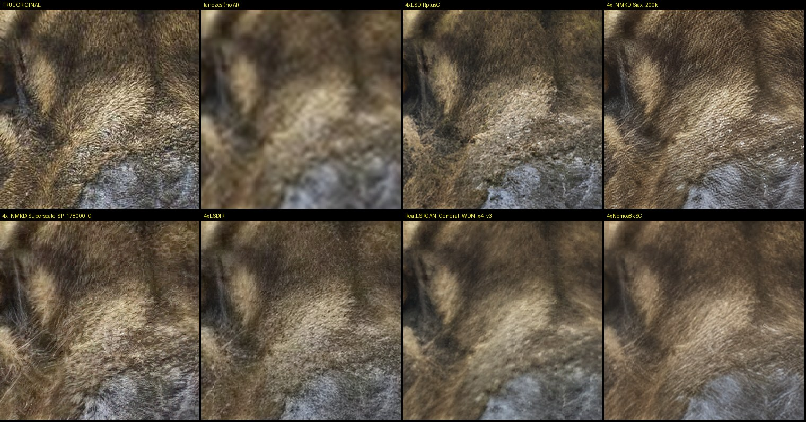
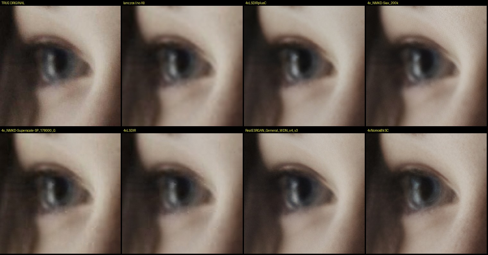
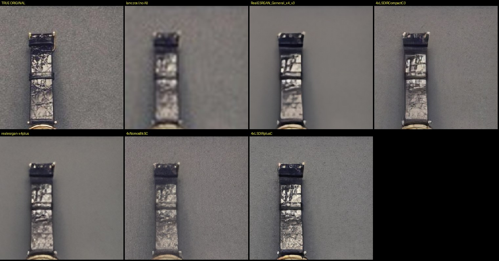
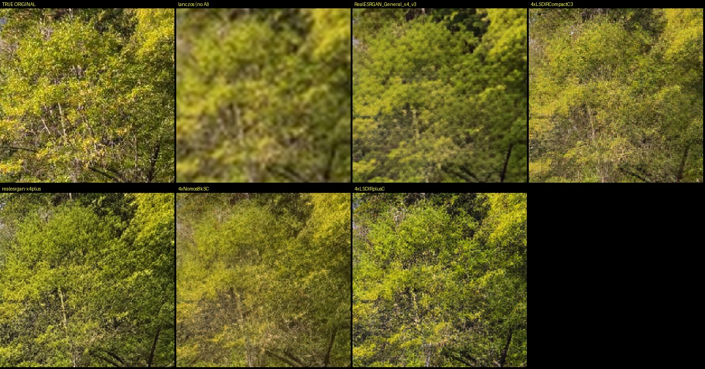

# Model test: which AI model for photos?

**Date:** 2026-11-09 · **Machine:** AMD Ryzen 5 5500U, built-in Radeon graphics (Vulkan)

## Method

1. 12 photos (portraits, fur, foliage, landscape, architecture, food, product flat-lay, street),
   1600×1066 px each. These are the **truth**.
2. Each one was shrunk to ¼ size (bicubic) and saved as JPEG quality 92, the kind of file you
   would want to enlarge.
3. Every model enlarged the small copy 4× back to 1600 px. The result was compared with the truth by
   numbers (PSNR/SSIM on brightness) and, more importantly, **by eye at 100%** on skin, eyes, fur,
   leaves and fine product texture.

The numbers favour a plain Lanczos enlargement (31.5 dB) because blur is "safe" on average-error
metrics. That's why the choice was made by looking at the crops. The question was which model looks
most like the real photo, not just the sharpest.

## Results

| Model | License | PSNR | SSIM | Time (12 photos) | Verdict |
|---|---|---|---|---|---|
| **4xLSDIRplusC** | CC-BY-4.0 | 29.79 | 0.823 | 184 s | **Most true to life.** Real hair strands, leather grain, foliage. Keeps soft focus soft. **Default.** |
| 4xNomos8kSC | CC-BY-4.0 | 30.07 | 0.800 | 174 s | Faithful but smoother. Good for blurry or heavily compressed files. **Kept as 2nd option.** |
| 4xLSDIRCompactC3 | CC-BY-4.0 | 31.08 | 0.831 | **7 s** | Natural, slightly soft, 25× faster. **Kept as Quick preview.** |
| 4xLSDIR | CC-BY-4.0 | 30.80 | 0.826 | 155 s | Good, a bit softer than LSDIRplusC. |
| 4x_NMKD-Siax_200k | WTFPL | 29.41 | 0.786 | 161 s | Adds artificial-looking texture. Twice the file size. |
| 4x_NMKD-Superscale-SP | — | 29.62 | 0.794 | 162 s | Similar to Siax: busy, invented detail. |
| realesrgan-x4plus | BSD-3 | 29.76 | 0.820 | 173 s | "Painted" look: smooth plastic skin, hard invented eyelid edges, flat backgrounds. |
| RealESRGAN_General_x4_v3 | BSD-3 | 30.01 | 0.839 | 11 s | Same painted look, fast. |
| RealESRGAN_General_WDN_x4_v3 | BSD-3 | 30.43 | 0.817 | 10 s | Denoised version, smoother still. |
| Lanczos (no AI) | — | 31.46 | 0.844 | — | Blurry baseline. |

4x-UltraSharp and 4x-Remacri are popular but **non-commercial** (CC-BY-NC-SA), so they were left out.

## Crops (TRUE ORIGINAL top-left, then no-AI, then models)

Fur: LSDIRplusC is the only one with real individual hairs.

Portrait eye (soft focus in the original): the photo models keep it soft; Real-ESRGAN invents hard edges.

Watch strap and background fabric: Real-ESRGAN wipes out the fabric texture.

Foliage:

## Speed note

On this laptop's built-in graphics the photo models run at about **2 minutes per input megapixel**
(the AI always works at 4×; measured: a 1.7 MP photo took 206 s end to end in the built app).
A 12 MP photo therefore takes around 25 minutes here. A dedicated graphics card is typically many
times faster. Quick preview is about 25× faster than the photo models.
